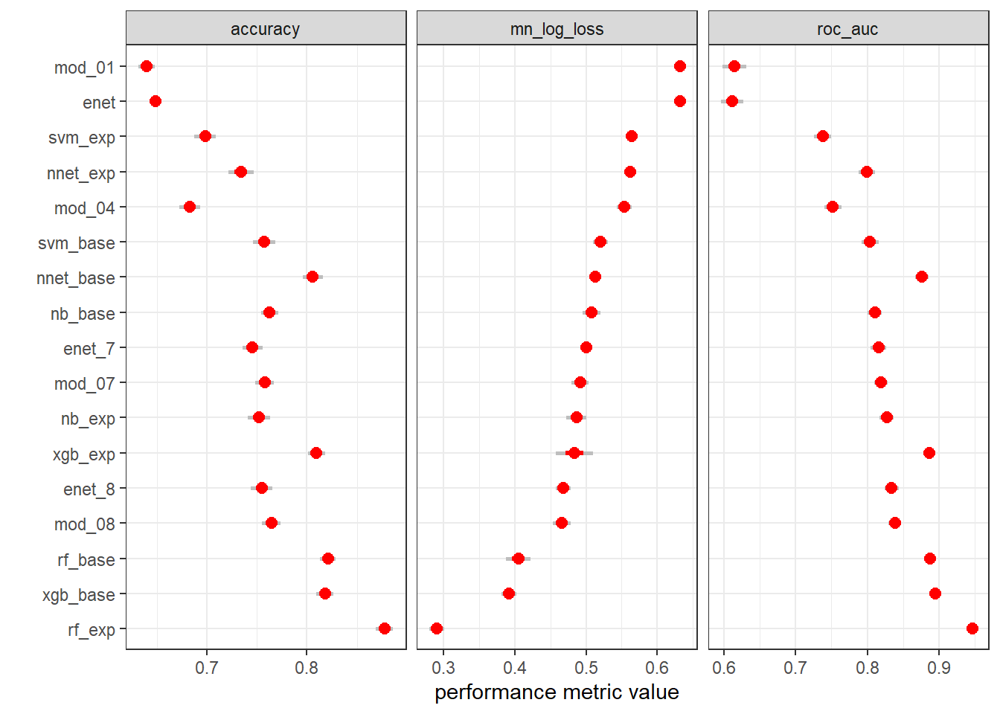
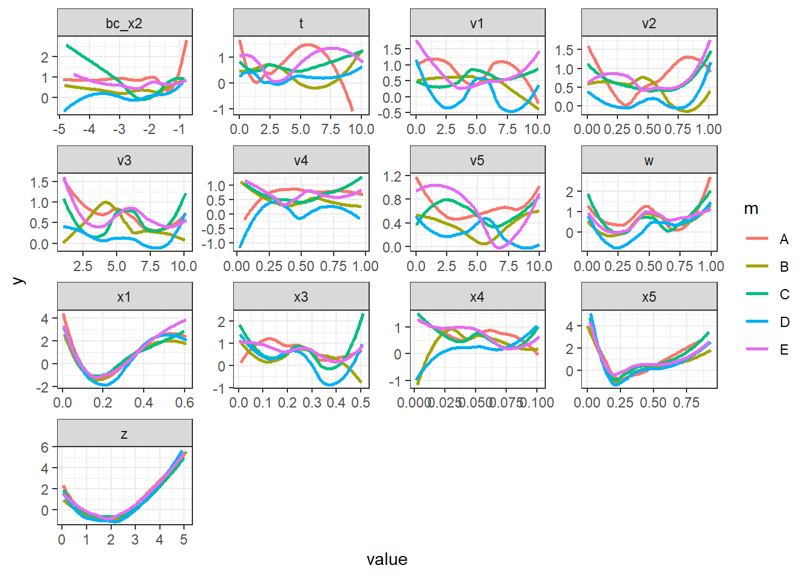
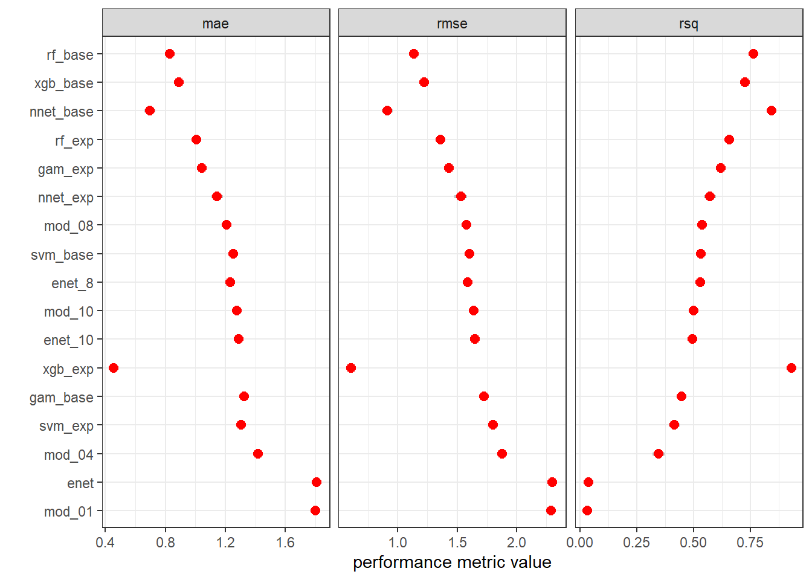
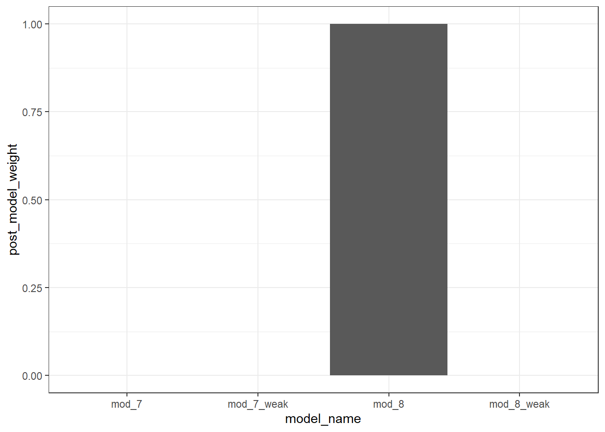
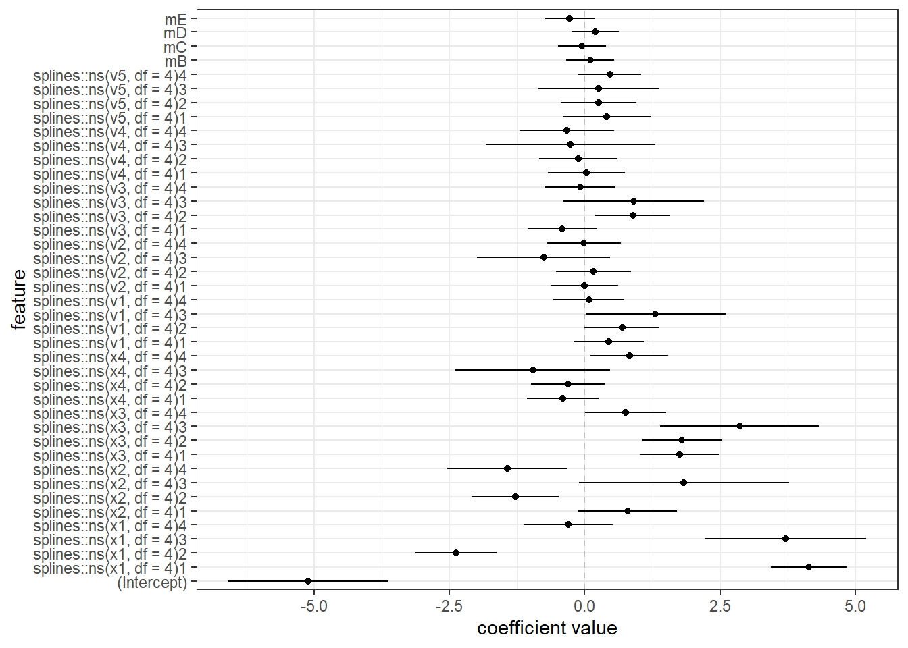
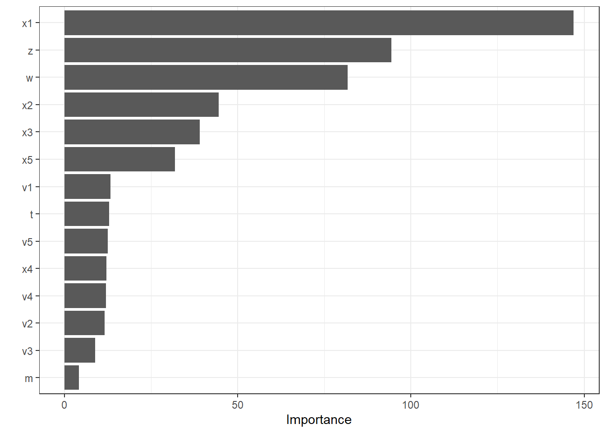
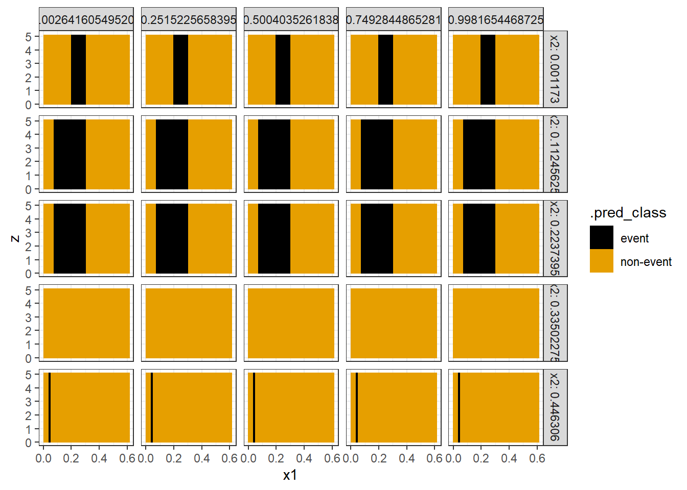

# Which recipe keeps the rust away?

**Optimizing coating constituents to minimize corrosion, using machine learning and Bayesian models in R**

A surface coating is a mixture of several constituents, made under different process settings on different machines. This project uses 1,252 production runs to answer two questions: *how do the recipe and the process drive the corrosion output*, and *which input settings should a manufacturer choose to minimize it?*

The analysis runs from exploratory analysis through regression and classification, with both frequentist machine-learning models and Bayesian models. The findings and recommended input settings were presented to **PPG Industries** in a written report.



*Nearly 20 classification models compared on accuracy, log loss and ROC AUC under 5-times-repeated 10-fold cross-validation. The random forest with the expanded feature set (bottom row) is best on all three.*

---

## Data

| Variable | Type | Description |
|---|---|---|
| `x1`–`x4` | Continuous | Mixture fractions of four constituents (a fifth, `x5 = 1 − (x1 + x2 + x3 + x4)`, is derived) |
| `v1`–`v5` | Continuous | Process variables |
| `m` | Categorical | Machine the run was made on (A–E) |
| `output` | Continuous, 0–1 | Corrosion response |

There are **1,252 runs** with no missing values. The data is not included in this repository (see [`data/README.md`](data/README.md)).

## Approach

### 1. Exploratory analysis and feature engineering ([`analysis/01_eda.Rmd`](analysis/01_eda.Rmd))

- Checked distributions and applied a Box-Cox transform to the skewed constituent `x2`; standardised all inputs.
- Found that the output looks roughly linear in the inputs overall, but becomes clearly **non-linear when broken down by machine**.
- Built domain-motivated **expanded features**: the mixture ratios `w = x2 / (x3 + x4)` and `z = (x1 + x2) / (x4 + x5)`, and the process interaction `t = v1 · v2`.



### 2. Regression on the logit-transformed output ([`02`](analysis/02_regression.Rmd), [`03`](analysis/03_regression_bayesian.Rmd))

- Fitted linear models of increasing complexity (additive, interactions, natural splines), elastic net, GAMs, neural networks, random forests, gradient-boosted trees and SVMs, each on the base and the expanded feature sets.
- **The expanded features made the biggest difference.** Simple additive linear models went from R² ≈ 0.03 to R² ≈ 0.35, and gradient-boosted trees with the expanded features were the best regression model on MAE, RMSE and R².



- **Bayesian linear regression:** the two best linear models were refitted in a Bayesian framework with weak and strong priors, using the **Laplace approximation** to the posterior. They were compared using the **model evidence** (marginal likelihood), and the posterior predictive uncertainty was visualised across the input space.

### 3. Classification ([`04`](analysis/04_classification.Rmd), [`05`](analysis/05_classification_bayesian.Rmd))

- Defined an *event* (a low-corrosion run) as `output < 0.33`, which covers about 35% of runs, and compared logistic regressions, elastic net, naive Bayes, neural networks, SVMs, random forests and XGBoost.
- **Random forest with expanded features was the best model, at about 92% cross-validated accuracy.**
- **Bayesian logistic regression** with the Laplace approximation: model evidence put essentially **all of the posterior model weight** on the expanded-feature model, and the posterior coefficient intervals show which inputs matter.

<p float="left">
  
  
</p>

### 4. From model to recommendation

Variable importance and prediction grids turn the models into guidance on settings. Constituent **`x1`** is the most important input, followed by the engineered ratios **`z`** and **`w`**. Low-corrosion runs (the event) are predicted only within a narrow band of `x1`, and **corrosion is predicted for essentially every run once `x2` rises above about 0.25–0.3**. That gives a concrete threshold for the recipe.

<p float="left">
  
  
</p>

## Key results

- Engineered mixture-ratio features were the single biggest improvement for every model family.
- **Regression:** gradient-boosted trees with expanded features gave the best predictions of the corrosion output.
- **Classification:** random forest with expanded features reached about **92% cross-validated accuracy**.
- **Bayesian models:** model evidence strongly favoured the expanded-feature model, and posterior intervals quantified the uncertainty in each effect.
- **Recipe guidance:** keep `x2` below about 0.25, and tune `x1` and the ratios `z` and `w`.

## Repository structure

```
.
├── analysis/                          # R Markdown source, run in order
│   ├── 01_eda.Rmd
│   ├── 02_regression.Rmd
│   ├── 03_regression_bayesian.Rmd
│   ├── 04_classification.Rmd
│   └── 05_classification_bayesian.Rmd
├── reports/                           # rendered HTML for each analysis (download to view)
├── figures/                           # plots used in this README
└── data/
    └── README.md                      # expected data format
```

## How to run

1. Place `fall2022_finalproject.csv` in `data/`.
2. Install the R packages used: `tidyverse`, `tidymodels`, `forecast`, `glmnet`, `mgcv`, `nnet`, `ranger`, `xgboost`, `kernlab`, `discrim`, `klaR`, `vip`, `doParallel`, `corrr`, `corrplot`, `visdat`, `ggthemes`, `broom`, `MASS` and `boot`.
3. Knit the notebooks in `analysis/` in numerical order. Tuned models are cached as `.rds` files next to the notebooks, so re-knitting after the first run is fast.

## Context

Final project for a graduate machine learning course at the University of Pittsburgh (Fall 2022), using data from PPG Industries.

**Tools:** R, tidymodels, ggplot2

---

*Vedant Kansara* · [GitHub](https://github.com/vedantkan) · [LinkedIn](https://www.linkedin.com/in/vedantkan/)
